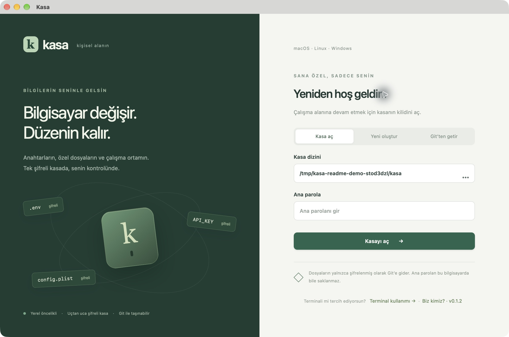
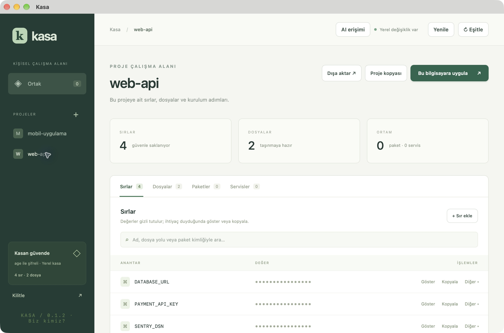
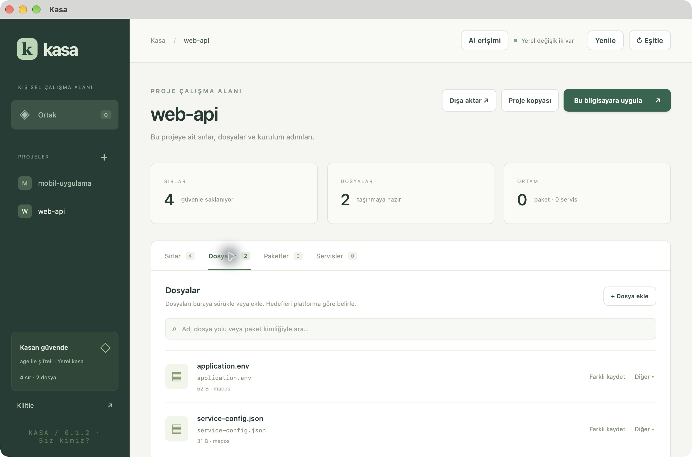
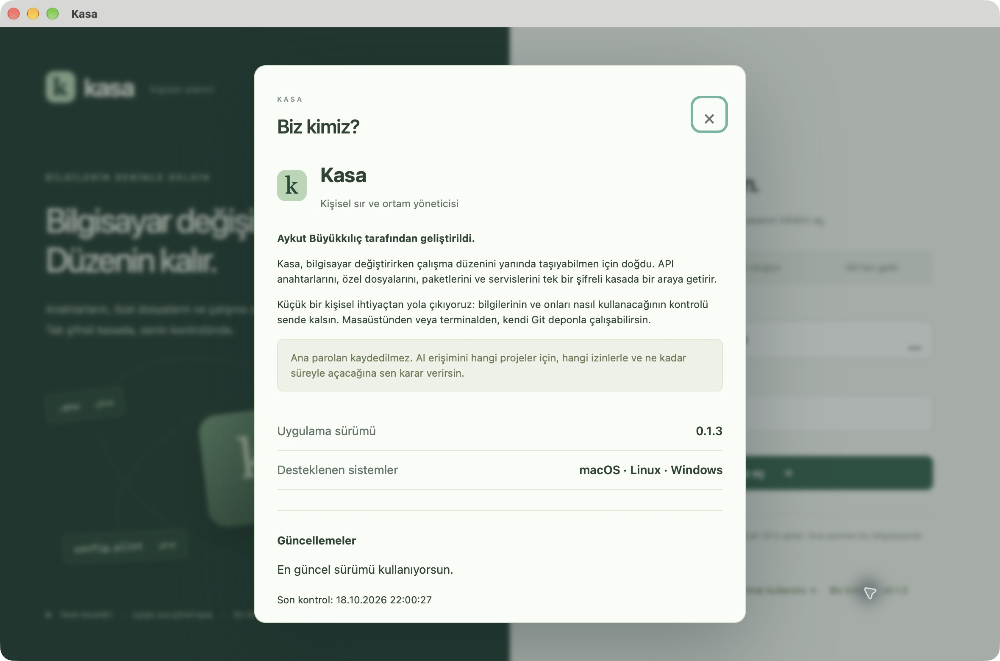

<p align="center">
  
</p>

<h1 align="center">Kasa</h1>
<p align="center"><strong>Bilgisayar değişir. Düzenin kalır.</strong></p>
<p align="center">API anahtarların, özel dosyaların ve çalışma ortamın.<br/>Tek şifreli kasada, senin kontrolünde.</p>
<p align="center">
  <a href="https://github.com/abuyukkilic/kasa-releases/releases/latest"><strong>↓ En güncel sürümü indir</strong></a>
  &nbsp; · &nbsp;
  <a href="#kurulum">Kurulum</a>
  &nbsp; · &nbsp;
  <a href="#ilk-kullanim">İlk kullanım</a>
  &nbsp; · &nbsp;
  <a href="#hakkımızda">Hakkımızda</a>
</p>



Kasa; Git’e açık olarak koymak istemediğin `.env`, `.plist`, API anahtarları ve küçük yapılandırma dosyalarını yanında taşıman için geliştirilen kişisel sır ve ortam yöneticisidir. Türkçe masaüstü arayüzünden veya bağımsız `kasa` terminal programından çalışabilirsin.

**Aykut Büyükkılıç tarafından geliştirildi.**

Bu depo uygulamanın **yayın deposudur**. Kurulum paketleri, sürüm notları ve tanıtım görselleri burada bulunur. Kaynak kodu özel depoda tutulur. Kişisel kasanı bu herkese açık depoya yüklememelisin.

## İndir

| Platform | Durum | İndirme |
| --- | --- | --- |
| macOS 12+ · Apple Silicon (M1 ve sonrası) | 0.1.4 yayımlandı | [DMG kurulum paketi](https://github.com/abuyukkilic/kasa-releases/releases/download/v0.1.4/Kasa_0.1.4_aarch64.dmg) |
| macOS · bağımsız CLI · Apple Silicon | 0.1.4 yayımlandı | [kasa terminal programı](https://github.com/abuyukkilic/kasa-releases/releases/download/v0.1.4/kasa_0.1.4_darwin-aarch64) |
| macOS · Intel | Henüz paket yayımlanmadı | — |
| Windows | Henüz paket yayımlanmadı | — |
| Ubuntu/Debian | Henüz paket yayımlanmadı | — |

[En güncel yayın ve sürüm notları →](https://github.com/abuyukkilic/kasa-releases/releases/latest)

> **Erken sürüm:** Mevcut macOS paketi Apple Developer kimliğiyle imzalanmış ve Apple tarafından notarize edilmiş bir dağıtım değildir. macOS güvenlik denetimleri açılışı engelleyebilir. Uygulama içi güncelleme paketinin imzası, Apple imzası/notarizasyonundan ayrı bir doğrulamadır.

## Neler yapabilirsin?

| İhtiyaç | Kasa’da karşılığı |
| --- | --- |
| API anahtarlarını bir arada tutmak | Başlangıçta gizlenen sırlar; gösterme, düzenleme ve kopyalama |
| Özel dosyalarını taşımak | Özgün baytlarıyla saklanan `.env`, JSON, `.plist` ve diğer küçük dosyalar |
| Projeleri ayırmak | **Ortak** alanı ve birbirinden bağımsız proje grupları |
| Yeni bilgisayarda düzenini kurmak | Dosya hedefleri, platforma göre paket kimlikleri ve desteklenen kullanıcı servisleri |
| Kasanı yedeklemek | Kendi özel Git deponla isteğe bağlı eşitleme; şifreli `.age` yedeği |
| Kayıtları yeniden kullanmak | Kayıt veya proje kopyalama; JSON, `.env` ve özgün dosya dışa aktarma |
| Terminalden çalışmak | Masaüstü açık olmasa da çalışan bağımsız CLI |
| AI aracına kontrollü erişim vermek | Senin açtığın kapsam, süre ve izinlerle yerel MCP bağlantısı |

### Sırlarını projene göre düzenle



Sır değerleri gizli başlar. İhtiyaç duyduğunda göster, kopyala veya düzenle. Arama alanıyla kayıtlarını bul; **Diğer** menüsünden kayıt işlemlerine ulaş.

### Dosyalarını da yanında taşı



Dosyaları seçerek veya sürükleyip bırakarak ekle. Platform başına hedef konumu belirle; **Farklı kaydet** ile özgün dosyayı dışarı al.

*Görseller 0.1.2 ve 0.1.3 sürümlerindeki gerçek uygulamadan alınmıştır. Tüm proje adları, anahtarlar ve dosyalar tanıtım için oluşturulmuş örnek verilerdir; gerçek kimlik bilgisi içermez.*

## Kurulum

1. [En güncel yayını](https://github.com/abuyukkilic/kasa-releases/releases/latest) aç ve Mac’in için `.dmg` dosyasını indir. Şu anki paket Apple Silicon içindir.
2. DMG’yi aç; **Kasa.app** dosyasını **Uygulamalar / Applications** klasörüne kopyala.
3. Kasa’yı Applications klasöründen başlat.
4. Git’in kurulu olduğunu kontrol et: terminalde `git --version`. Kasa yerel kasası için de Git kullanır. GitHub hesabı ise yerel kullanım için gerekmez.

Paket kurulumunu kullanacaksan Homebrew ayrıca kurulu olmalı. GitHub hesabını uygulamadan bağlamak ve özel depo oluşturmak için **GitHub CLI (`gh`)** gerekir. Bunlar Kasa kurulum paketine dahil değildir.

Zaten Homebrew kullanıyorsan:

```sh
brew install git gh
```

### Terminal komutunu kullanmak

Uygulama içindeki **Terminal kullanımı** ekranı, bu kurulumda çalışan tam CLI yolunu gösterir. PATH ayarı yapmadan da çalıştırabilirsin:

```sh
/Applications/Kasa.app/Contents/Resources/cli/kasa --help
```

Kısa `kasa` komutu için paketle gelen programı kullanıcı dizinine kopyalayabilirsin:

```sh
mkdir -p "$HOME/.local/bin"
cp /Applications/Kasa.app/Contents/Resources/cli/kasa "$HOME/.local/bin/kasa"
chmod 700 "$HOME/.local/bin/kasa"
export PATH="$HOME/.local/bin:$PATH"
kasa --help
```

`export PATH` bu terminal oturumu içindir. Kalıcı kullanmak için aynı satırı kullandığın kabuğun başlangıç dosyasına, örneğin `~/.zshrc` içine ekle. Ayrı kopyaladığın CLI’ı yeni sürümde yeniden kopyalayarak güncelle.

<a id="ilk-kullanim"></a>

## İlk kullanım

### 1. Kasanı oluştur

**Yeni oluştur** seçeneğini aç. Mevcut kaynak kodu projenin dışında, kasaya ait ayrı bir klasör seç. En az **8 karakterli**, uzun ve benzersiz bir ana parola belirle.

Git yedekleme bölümünde üç yolun var:

- **Şimdilik yalnızca bu bilgisayarda:** Kasan yerel olarak çalışır.
- **GitHub’da yeni özel depo oluştur:** Hesabını bağla, depo adını seç ve açık onay ver. Kasa yalnızca özel depo oluşturur.
- **Mevcut depoya bağlan:** GitHub’daki boş özel deponu seç veya Git adresini kendin gir.

İlk şifreli kasanın yüklenmesini ayrıca seçebilirsin. Sonraki eşitlemeleri **Eşitle** ile sen başlatırsın; sürekli arka plan eşitlemesi yoktur.

### 2. Bir proje ve kayıt ekle

Sol taraftan proje oluştur veya **Ortak** alanını seç. **Sırlar** sekmesinden API anahtarını, **Dosyalar** sekmesinden özel dosyanı ekle. Dosyalar sürükleyip bırakılarak da eklenebilir.

Ortak ve proje grupları bağımsızdır; kendiliğinden birleştirilmez.

### 3. Kullan, kopyala veya dışa aktar

- **Kopyala:** İlgili sır değerini panoya alır.
- **Dışa aktar:** Seçili grubu JSON veya `.env` olarak; tüm kasayı şifreli `.age` yedeği olarak kaydeder.
- **Farklı kaydet:** Bir dosyayı özgün içeriğiyle dışarı çıkarır.
- **Proje kopyası / Diğer:** Kayıt veya projenin yeni bir kopyasını oluşturur; çakışan kayıtların üzerine yazmaz.

JSON, `.env` ve özgün dosya dışa aktarımları **açık içerik** üretir ve onay ister. Bu dosyaları Git’e yanlışlıkla eklememeye dikkat et.

### 4. Bu bilgisayara uygula

Dosya hedeflerini, paket kimliklerini ve servislerini tanımladıktan sonra **Bu bilgisayara uygula** ekranında yapılacak değişiklikleri incele. İşlem onayından sonra başlar. Farklı bir mevcut dosyanın üzerine yazılacaksa onay alınır ve yerel yedek tutulur.

macOS’ta Homebrew ve kullanıcı LaunchAgent’ları; Linux’ta apt ve `systemd --user`; Windows’ta winget kullanımı için yapı bulunur. Windows servis yönetimi ilk sürümde yoktur. Yayımlanmamış platform paketleri için yukarıdaki indirme tablosunu kontrol et.

### 5. Başka bilgisayarda aç

Kasanı özel Git deponla eşitledikten sonra yeni bilgisayarda **Git’ten getir** seçeneğini kullan. Henüz mevcut olmayan bir hedef klasör seç, depoyu indir ve ana parolanla aç.

Git kullanmadan yedek almak için şifreli `.age` dışa aktarımını kullanabilirsin. Geri açmak için yedek dosyanın bir kopyasını yeni, ayrı bir klasöre `vault.age` adıyla koy; **Kasa aç** ile bu klasörü seç. Mevcut kasanın üzerine yazma.

## Terminalden örnek kullanım

```sh
# Tüm komutları gör
kasa --help

# Yeni yerel kasa ve proje
kasa --dir /tam/yol/kasam init
kasa --dir /tam/yol/kasam group web-api

# Anahtar ve dosya ekle
kasa --dir /tam/yol/kasam secret set web-api API_KEY
kasa --dir /tam/yol/kasam add web-api .env --target .env

# Kayıtları listele
kasa --dir /tam/yol/kasam list web-api

# Önce yapılacakları gör, ardından uygula
kasa --dir /tam/yol/kasam apply web-api --root /tam/yol/projem --dry-run
kasa --dir /tam/yol/kasam apply web-api --root /tam/yol/projem

# Sırları yalnızca başlatılan sürece ortam değişkeni olarak ver
kasa --dir /tam/yol/kasam run web-api -- python app.py

# Özel depo bağlantısı ayarlıysa eşitle
kasa --dir /tam/yol/kasam sync
```

CLI kasa işlemleri için parolayı gizli girdiden ister; masaüstünün açık oturumunu kullanmaz. `secret set` sır değerini de gizli girdiden alır.

## AI araçlarıyla kullanım

Kasayı açmak AI erişimini kendiliğinden açmaz. **AI erişimi** ekranında:

1. Tek veya birden çok proje seç; istersen tüm projelere izin ver.
2. Sır ve dosya okuma izinlerini belirle.
3. Süreyi seç veya mevcut uygulama oturumu için süresiz izin ver.
4. Gerekliyse **ayrıca** tek bir projeye yeni kayıt ekleme izni aç ve o projenin kaynak klasörünü seç.
5. Ana parolanla onayla; ekrandaki MCP yapılandırmasını AI aracına ekle.

AI kendine izin veremez veya kasayı açamaz. Ekleme izni mevcut kayıtları değiştirme ya da silme yetkisi vermez. **Kilitle**, **AI erişimini şimdi kapat**, pencereyi kapatma veya uygulamadan çıkış izinleri iptal eder. Süresiz izin yeniden başlatmada otomatik açılmaz.

## Güncellemeler

Kasa açılışta ve **6 saatte bir** yeni sürüm kontrolü yapar. **Biz kimiz? → Güncellemeleri kontrol et** ile istediğin zaman kontrol edebilirsin.

Yeni sürüm bulunduğunda bildirim görünür. Sürüm notlarını inceleyip **İndir ve güncelle** seçeneğini kullan. Paket imzası doğrulanır; kurulum öncesinde kasa kilitlenir ve AI izinleri kapatılır. Kurulumdan sonra **Yeniden başlat** ile devam et.

0.1.1 ve daha eski sürümlerde önce güncel DMG’yi bir kez elle kurmak gerekir. Yeni uygulamayı Applications klasörüne kopyalamak kasa dosyalarını silmez; yine de güncelleme öncesi şifreli yedek almak iyi bir alışkanlıktır.

## Güvenlik ve sınırlar

- İçerik ve kurulum tanımları parola ile şifrelenen tek `vault.age` dosyasında tutulur. Şifreleme için `age` kullanılır.
- Ana parola kaydedilmez ve **unutulursa kurtarılamaz**.
- Kasa elle ve 10 dakika hareketsizlikten sonra kilitlenir. Açık AI izni varken hareketsizlik kilidi duraklar; pencereyi kapatmak kasayı kilitler.
- Sır kopyası, pano içeriği hâlâ aynıysa 30 saniye sonra temizlenir. Başka bir uygulamanın aldığı kopya geri silinemez.
- Git’e yalnız şifreli kasa gönderilir. Eşzamanlı yerel/uzak değişikliklerde otomatik birleştirme veya zorla gönderme yapılmaz.
- Parola değişikliği mevcut kasayı yeniden şifreler; Git geçmişindeki eski sürümleri değiştirmez.
- Geri yüklenen dosyalar, açık dışa aktarımlar ve yerel dosya yedekleri kullanım gereği cihazda açık bulunur.
- Küçük kişisel yapılandırmalar hedeflenir: dosya başına 10 MiB, toplam kasa için 64 MiB sınırı vardır.
- İlk sürümde parola kurtarma, arka plan Git eşitlemesi ve Windows servis yönetimi bulunmaz.

## Sık karşılaşılan durumlar

**“Bu klasörde kasa bulunamadı (vault.age eksik)”**  
Kasa dosyasının bulunduğu klasörü seç. Henüz kasan yoksa **Yeni oluştur**; uzak depon varsa **Git’ten getir** ile başla.

**“Kasa klasörü bulunamadı”**  
Klasör taşınmış veya silinmiş olabilir. Doğru konumu yeniden seç. Kasayı geri getirmek için özel Git deponu veya şifreli yedeğini kullanabilirsin.

**`kasa: command not found`**  
Uygulamadaki **Terminal kullanımı** ekranından tam komutu kopyala veya yukarıdaki PATH kurulumunu yap.

**GitHub’a bağlanamıyorum.**  
Git ve GitHub CLI’ın kurulu olduğunu, hesabına giriş yaptığını kontrol et. Var olan dolu bir kasa deposunu bağlamak yerine **Git’ten getir** ile aç.

**Parolamı değiştirmek istiyorum.**  
Kasayı aç; alt bölümdeki **Parola değiştir** düğmesini veya terminalde `kasa --dir /tam/yol/kasam passwd` komutunu kullan.

## Hakkımızda

**Kasa, Aykut Büyükkılıç tarafından geliştirildi.**



Bir bilgisayara bağlı kalan kişisel anahtarları, dosyaları ve çalışma düzenini daha kolay taşımak için yola çıktı. Amaç; günlük kullanımda sade, ihtiyaç duyulduğunda terminalden de yönetilebilen ve kontrolü kullanıcıda kalan bir araç sunmak.

Sorun veya öneri için [yeni bir issue açabilirsin](https://github.com/abuyukkilic/kasa-releases/issues/new). Ana parolanı, API anahtarlarını, `vault.age` dosyanı veya özel içeriklerini issue’ya ekleme. Ekran görüntülerindeki özel bilgileri paylaşmadan önce kaldır.
